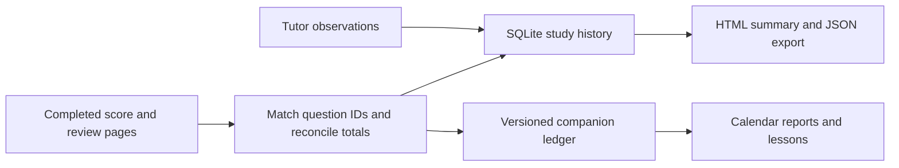

# Blueprint Hope

Blueprint Hope turns completed MCAT practice reports into a local study history. It answers questions a score alone cannot, such as “How often did I miss enzyme kinetics questions this week?” and “Which attempts led my tutor to flag that topic?” Each summary links back to the attempts behind it.

The core runs on Python and SQLite. A Windows collector imports supported Blueprint reports through Playwright. An optional study companion uses that history for calendar reports, interactive lessons, and delayed recall checks.

## Try it with synthetic data

From the repository root, run this with Python 3.10 or later. The demo uses the standard library and a temporary database.

```sh
python -m examples.demo
```

The demo imports four question attempts and one assessment, records a tutor observation, then imports the same snapshot again.

```text
Blueprint Hope | synthetic study session
First import: 5 records inserted
Replay: already_imported (0 records inserted)
Study notes retained: 1
Question history coverage: partial

Topic                       Correct / answered (7 days)
Enzyme kinetics             1 / 3
Passage inference           1 / 1
```

The enzyme kinetics note refers to two specific missed attempts. Both IDs appear in the exported history, so a reader can check the evidence behind the note. [Input snapshot](examples/normalized_snapshot.json) · [Tutor observation](examples/observation.json) · [Example JSON export](examples/demo_state.json)

## How a report becomes study history



| When this happens | What the system does |
| --- | --- |
| A learner captures the same report twice | A content hash identifies the replay. The import preserves attempt counts and the original capture time. |
| A learner retakes a question in a new activity | The activity and question IDs identify the attempt together. Summaries retain both attempt count and unique question count. |
| Two records disagree at the same source revision | The companion archives the conflicting capture for inspection and keeps the previous records available. A compatible older-format replay preserves the detailed report fields. |
| A capture covers only part of the account | Missing records stay in history. The export carries coverage and freshness for each collection, and answered accuracy includes its denominator. |

The data contract documents the timestamps, IDs, coverage flags, and rolling windows. [Data format](FORMAT.md) · [Report adapter](blueprint_report.py) · [Companion revision handling](companion/ingest.py) · [Regression tests](tests/test_companion.py)

## Use your own reports

The automatic capture workflow uses Windows, installed Chrome, and a local report plan seeded from a validated completed report. On first setup, create the seed from the matching score and identity responses as described in the [browser guide](LOCAL_BROWSER.md).

```powershell
py -3.12 -m venv .venv
.venv\Scripts\python.exe -m pip install -r requirements-browser.txt
.venv\Scripts\python.exe blueprint_run.py --local-only --from-capture private/report-capture.json
```

Sign in through the dedicated Chrome window. Later runs can use `blueprint_run.py --local-only` with the saved plan. The collector opens `private/study_summary.html` and writes the structured export to `private/study_state.json`. Browser state, captures, and both SQLite databases stay under the ignored `private/` directory. The default Windows launcher also offers local API-key setup. [Browser guide](LOCAL_BROWSER.md) · [Credential setup](docs/CHATGPT.md)

The Windows handoff and adapter have been verified with one completed report. Account-wide discovery, Qbank, flashcards, and progress history remain outside the verified capture scope. The two report responses do not independently establish learner identity. Use a dedicated profile and report plan for each learner.

## Run the study companion

With a Python 3.12 virtual environment active, run the scripted lesson demo. It persists three synthetic answers, advances the clock for a delayed check, and saves a versioned weekly report.

```sh
python -m pip install -r requirements-companion.txt
python -m companion.demo
```

For your own history, `python -m companion setup --timezone America/New_York` configures the ledger. Substitute your IANA timezone. The companion guide covers migration, reports, context imports, backups, and optional hosting. Live ChatGPT delivery, hosted PostgreSQL, and Google Drive publishing still need end-to-end verification. [Companion guide](docs/COMPANION.md) · [Google Drive export](docs/DRIVE.md) · [Study coach templates](prompts/project_instructions.md)

## Verification

Run the offline suite in an active Python 3.12 virtual environment. It exercises report reconciliation, database migrations, replay behavior, report cutoffs across daylight-saving changes, lesson state, and the authenticated MCP transport. GitHub Actions is configured to run the demo and tests on Windows and Linux.

```sh
python -m pip install -r requirements-browser.txt -r requirements-companion.txt
python -m unittest discover -v
```

Contributions should use synthetic data in fixtures and issue reports. [MIT license](LICENSE)
